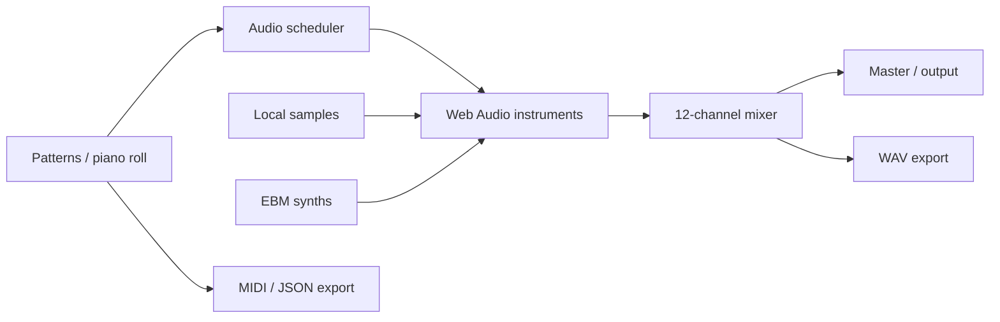

# Studio Niko Music Lab Pro

**A browser-native music workstation with original EBM synthesis and local audio processing.**

Une station musicale légère pour composer, synthétiser, arranger et exporter de la musique sans service de génération distant.

    

**STUDIO NIKO DESIGN** · Build smart. Stay lightweight. Create without limits.

[Ouvrir la démo / Open demo](https://niko-music-lab.vercel.app/) · [Signaler un problème / Report an issue](https://github.com/Nikoju1977/niko-music-lab/issues)

> [Insérer ici un GIF de démonstration / Insert demo GIF here]

[English overview](#english-overview) · [Documentation technique](#documentation-technique-fr) · [Roadmap](#roadmap--contribution)

## Pourquoi ce projet ?

Rendre la production électronique accessible immédiatement, sans DAW à installer ni compte obligatoire. Le moteur Web Audio et les synthétiseurs EBM maison privilégient un traitement local et une architecture lisible.

## Architecture & sécurité

Audio synthesis and file processing use browser APIs. Local storage is not encrypted by default; microphone access requires permission. No claim of measured latency, professional mastering certification or universal offline behavior is made.

**État de validation :** inspection documentaire et du code source lors de cette mise à jour ; pas de nouvelle exécution de l'application, de mesure de performance ni de test matériel.

## Documentation technique (FR)

Station de production musicale gratuite dans le navigateur, signée Studio Niko.

**Application publique :** https://niko-music-lab.vercel.app/

## Fonctionnalités

- Séquenceur de 16 pas, **12 pistes**, 4 patterns A–D.
- Piano roll polyphonique sur 3 octaves pour les 6 instruments mélodiques.
- Arrangement jusqu'à 16 mesures et mixeur 12 canaux.
- Générateur de grooves Techno, EBM / Industrial, House / Afro, Acid et Drum & Bass.
- 3 synthétiseurs EBM originaux **sans samples préenregistrés** :
  - **PULSE 101 :** basses analogiques avec deux oscillateurs, suboscillateur, filtre à enveloppe et saturation.
  - **FM HAMMER :** timbres métalliques par modulation de fréquence, filtre passe-bande et enveloppes percussives.
  - **DARK MACHINE :** nappes sombres avec oscillateurs désaccordés, suboscillateur et enveloppe longue.
- 3 presets par synthé EBM (9 au total) ; 4 réglages propres à chaque piste (filtre/tone, caractère, durée, saturation), enregistrés dans le JSON.
- Moteur audio Web Audio API ; mixage, panoramique, mute/solo, filtres et effets master.
- Import de samples WAV / MP3 / OGG / M4A selon le navigateur (25 Mo maximum).
- Export WAV stéréo 44,1 kHz PCM 16 bits, export MIDI et sauvegarde/restauration de projet JSON.
- Interface responsive et commandes tactiles.

## Composer en EBM

1. Choisir **EBM / Industrial** dans le menu de génération, puis cliquer **Générer un pattern**.
2. Sélectionner les pistes **PULSE 101**, **FM HAMMER** ou **DARK MACHINE** dans la liste des instruments.
3. Tester les presets et ajuster les quatre paramètres dans **SOUND DESIGN**.
4. Programmer des notes dans **Séquenceur** ou **Piano roll**.
5. Arranger les patterns, mixer les pistes et exporter le résultat.

## Installation locale

Pour une utilisation locale complète, télécharger **index.html** et **ebm-synths.js** dans le même dossier, puis ouvrir `index.html` dans un navigateur Web Audio moderne. Aucun compte ni service de génération externe n'est requis. Les capacités audio dépendent de l'appareil et du navigateur. Sur mobile, un premier appui sur Lecture est nécessaire pour autoriser l'audio.

## Déploiement

- Dépôt GitHub : https://github.com/Nikoju1977/niko-music-lab
- Site Vercel : https://niko-music-lab.vercel.app/
- La branche `main` est reliée au déploiement Vercel.

## Vérification et limites

- La présence des 12 pistes et des nouveaux contrôles a été vérifiée dans un navigateur automatisé.
- Le déploiement et les ressources publiques sont contrôlés séparément.
- La qualité sonore perçue, les téléchargements WAV/MIDI et la compatibilité sur tous les appareils doivent être confirmés par des essais utilisateur ou des tests audio supplémentaires.
- Les trois synthés sont des créations **originales inspirées de l'esthétique EBM**, et non des émulations matérielles exactes de SH-101, DX7 ou d'autres machines.

## Attribution

Projet indépendant. Il n'intègre pas de code ni d'éléments graphiques de LMMS.

## Roadmap & contribution

Prochaines étapes proposées, non présentées comme terminées :

- [ ] Validate long playback and audio scheduling on physical devices.
- [ ] Test WAV and MIDI exports against reference files.
- [ ] Measure CPU load and audio dropouts on low-memory hardware.
- [ ] Improve reproducible tests for EBM presets and project restoration.

Les retours d'utilisation, rapports de bugs et propositions d'amélioration sont les bienvenus via les [issues](https://github.com/Nikoju1977/niko-music-lab/issues). Pour une première contribution, rechercher ou proposer une issue portant le label `good first issue` ; ce label n'est pas garanti déjà créé. Les modifications de code doivent respecter la notice de droits existante et, si nécessaire, obtenir l'autorisation du titulaire. Ne jamais publier de clé API, données personnelles ou fichiers sensibles.

## English overview

The workstation includes a 16-step sequencer with 12 tracks, four patterns, a polyphonic piano roll, up to 16 bars of arrangement and a mixer. PULSE 101, FM HAMMER and DARK MACHINE are original Web Audio synth designs, not exact hardware emulations. Local sample import and WAV/MIDI/JSON exports are implemented in the source. Physical-device audio quality and export validation are still outstanding.

### Quickstart

Clone the repository, keep `index.html` and `ebm-synths.js` together, then open `index.html` in a modern browser. For PWA and microphone features, use an appropriate secure context. Start playback with a user gesture.

### Contribution

Report a reproducible browser audio or export issue with steps and browser version (`good first issue`, suggested label). Feedback is welcome; code contributions and redistribution remain subject to the existing rights notice. No new runtime tests or benchmarks were performed during this documentation update.

## Licence & auteur / License & author

**© 2026 Studio Niko Design — [Nikoju1977](https://github.com/Nikoju1977).** Original contributions are subject to the existing [copyright notice](LICENSE.md), all rights reserved; public source access does not constitute an open-source license. Third-party components retain their own licenses. No license changes are made by this README.
